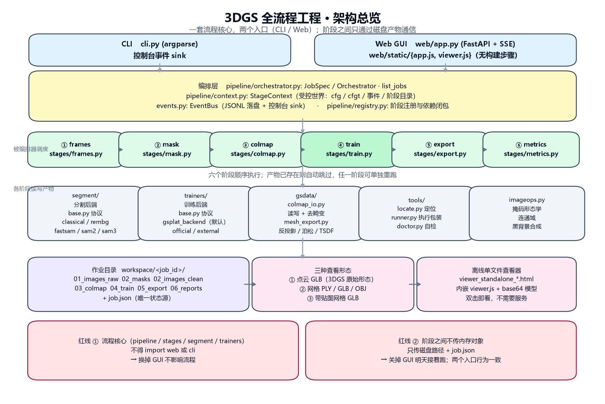
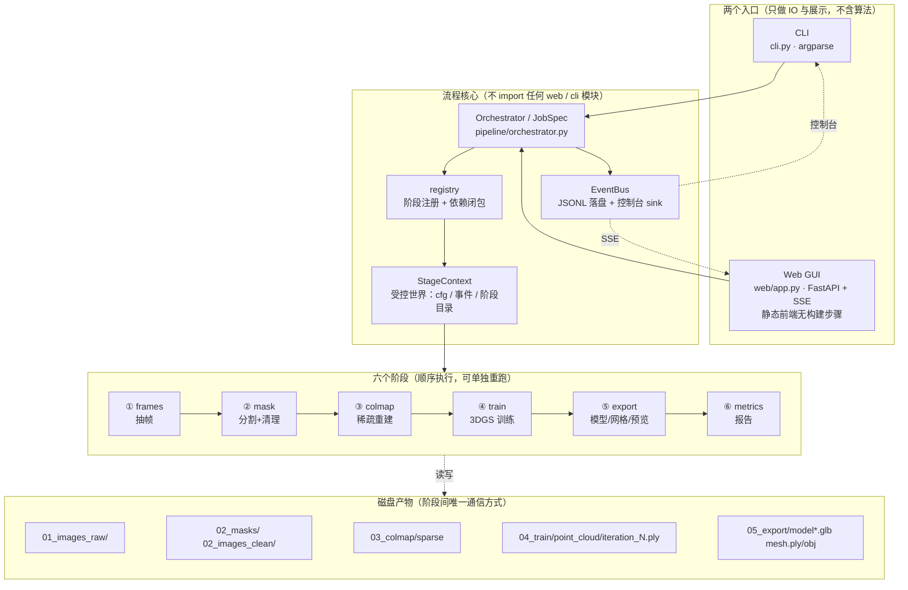
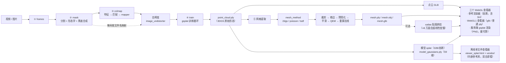

# 01 · 架构说明

> 目标：**一套流程核心，两个入口（CLI / Web）**，任一入口行为完全一致，
> 且每个阶段都能单独重跑、整个作业能断点续跑。
> 配套阅读：[05-训练框架](05-训练框架.md)（训练细节）、[04-文件树](04-文件树.md)、
> [03-踩坑记录](03-踩坑记录.md)（每个设计决定的实测依据）。

## 0. 一张图看全（PNG，任何阅读器都能看）



> 由 `python scripts\make_architecture_png.py` 生成，可重复运行。
> 下文用 Mermaid 给出同样的分层，便于在 GitHub / VS Code 里缩放查看。

---

## 1. 总览



**关键点**：两个入口都**只**构造 `JobSpec` 并交给同一个 `Orchestrator`。
GUI 里任何操作都会同时打印**等价 CLI 命令**，因此"两端同构"是可验证的，
而不是靠约定。

---

## 2. 架构红线（代码评审按这几条查）

| # | 规则 | 原因 |
|---|---|---|
| 1 | `stages/` `pipeline/` `segment/` `trainers/` 不得 import `web` 或 `cli` | 保证换掉 GUI 不影响流程 |
| 2 | 阶段之间不传内存对象，只传**磁盘路径 + `job.json`** | 关掉 GUI，明天接着跑 |
| 3 | 每个阶段声明 `inputs` / `outputs` | 编排器据此自动跳过已完成阶段 |
| 4 | 外部程序一律经 `tools/locate.py` + `tools/runner.py` | 缺工具时给**可执行的**修复建议 |
| 5 | 凭据只走 `credentials.py`，永不写进 `config.toml` | 防误提交 |
| 6 | 任何 UI 动作都要能翻译成一条 CLI 命令 | 两端同构可验证 |
| 7 | 配置默认值只有**一处**权威来源（`config.DEFAULTS`） | 曾有"三处来源"导致改默认值不生效（见 03/G44） |
| 8 | 数值读取用 `ctx.cfgt()`，不用 `ctx.cfg(k, d) or d` | `or` 会吞掉合法的 `0`/`False`（见 03/G44） |

---

## 3. 阶段契约

| 阶段 | requires | 输入 | 输出 |
|---|---|---|---|
| `frames` | — | 视频 / 图片目录 | `01_images_raw/`、`crop.json`（自动裁剪框，见下）|
| `mask` | frames | `01_images_raw/` | `02_masks/`、`02_images_clean/` |
| `colmap` | mask | `02_images_clean/`(+masks) | `03_colmap/sparse/<best>/*.bin`、`report.json` |
| `train` | colmap | COLMAP 模型 + 清理图 | `04_train/point_cloud/iteration_N/point_cloud.ply`、`04_train/data/masks/` |
| `export` | train | PLY | `05_export/{model.splat, model_gaussians.ply, model_mesh.*, model_mesh_textured.glb, viewer_splat.html, preview_*.png}` |
| `metrics` | train | 各阶段 metrics | `06_reports/report.md` |

> ⚠️ **自动裁剪必须在 `frames`（COLMAP 之前）**，不能放在 `train`。
> 放错时 COLMAP 会先把整个房间重建出来（点云 bbox 13.7 vs 5.7），
> 之后无论怎么裁，位姿与点云都已经带着背景了（03/G112）。
> `crop.json` 记录裁框与判据（帧间时间方差），供复现与 GUI 展示。
> 开关是 `export.auto_crop`；训练阶段另有 `auto_crop_in_train`，**默认 false** ——
> 它是在错误位置做同一件事，留着只为复现历史实验。

---

## 4. 数据流（含三种查看形态）



> **渲染像素不由我们实现**（03/G116）：高斯交给 vendored
> `@mkkellogg/gaussian-splats-3d`（MIT，three.js r160，WebGL2，原生支持 3DGS PLY 含 SH）；
> 网格/普通点云交给本项目自带的 WebGL1 查看器；
> 想"所见即所得"还可以让服务端用 gsplat 渲一张 PNG（`/api/render/{job}`）。
> 这样做的目的很实际：**自研光栅化的差距会被误读成模型质量差**。
```

---

## 5. 模块地图

```text
src/gsflow/
├─ paths.py            所有宿主路径与子进程环境（TEMP/缓存全部关进工作区）
├─ config.py           默认值 → config.toml → 运行时覆盖（点路径）；DEFAULTS 是唯一权威
├─ credentials.py      API Key / HF Token / 镜像 / 代理
├─ errors.py           统一异常；ToolMissingError 带 advice
├─ events.py           EventBus + JSONL 落盘 + 控制台 sink
├─ imageops.py         掩码形态学、连通域、黑背景合成（纯 numpy/PIL）
├─ cli.py              gsflow 命令族
├─ pipeline/           base / context / registry / orchestrator
├─ stages/             frames → mask → colmap → train → export → metrics
├─ trainers/           gsplat（默认）/ official / external + 训练器本体
├─ gsdata/             colmap_io（读写+去畸变）、mesh_export（反投影/泊松/TSDF/后处理）
├─ segment/            分割后端：classical / rembg / fastsam / sam2 / sam3
├─ tools/              locate（定位）/ runner（执行包装）/ doctor（自检）
└─ web/                FastAPI app + jobs 管理器 + static 前端
   └─ static/          index.html / app.js / style.css
      ├─ viewer.js     WebGL1 查看器：glb 与**普通** ply（网格、点云）
      ├─ refviewer.js  高斯显示的适配层（渲染像素交给 vendored 库，无自研着色器）
      ├─ vendor/       three.module.js + gaussian-splats-3d.module.js（离线）
      └─ splat.legacy.js  已下线的自研泼溅器（归档，不被加载）
```

> **为什么要分两个查看器**：高斯需要 WebGL2 + 实例化 + 逐帧深度排序 + 预乘 alpha；
> 网格/点云只需要 WebGL1。曾经试图用一个自研 WebGL1 渲染器同时做两件事，
> 结果是黑屏两次、且**看起来像模型坏了**（03/G110、G114、G116）。

---

## 6. 可扩展点

| 想加什么 | 改哪里 |
|---|---|
| 新的分割模型 | 实现 `segment/base.py:Segmenter`，在 `BACKENDS` 注册 |
| 新的训练器（LiteGS / Faster-GS…） | 实现 `trainers/base.py` 协议，在 `pick()` 注册；或用 `train.backend=external` |
| 新的阶段（inpaint / 4DGS…） | 写 `Stage` 子类并在 `stages/__init__.py` 注册，CLI/GUI 自动出现 |
| 新的外部工具 | 在 `tools/locate.py` 的 `CANDIDATES` / `ADVICE` 加一项 |
| 新的网格提取方法 | 在 `stages/export.py` 的 `mesh_method` 分支加一条，复用 `gsdata/mesh_export.py` |
| 任意配置项调参（不改前端） | GUI「新建作业 → 高级参数」文本框，每行 `段.键=值` |

---

## 7. 并发与资源

- **单卡串行**：`runtime.max_parallel_jobs` 默认 1。两个作业同时抢 8GB 显存必 OOM；
  而且**并发训练会争抢 `gsplat_cuda.pyd` 的编译**，报 `LNK1104`（见 03/D1）。
- **作业线程**：`web/jobs.py` 用后台线程跑 `Orchestrator`，事件写进该作业的 `EventBus`；
  浏览器通过 `/api/run/{id}/stream`（SSE）实时消费。
- **取消**：`threading.Event` 逐迭代检查；取消发生在迭代边界，已保存的检查点仍可用。
- **显存守护**：<10GB 时自动降分辨率并限制 `cap_max`（高斯数量上限）。

---

## 8. 产物与别名

- 作业目录：`workspace/<job_id>/`（真实路径 `F:\3dgs-and-ai\workspace`）。
- `D:\3dgs-workspace\workspace\<job_id>` 是它的目录链接，方便在 D 盘查看。
- 每个作业的 `job.json` 是唯一状态源：参数快照、阶段状态、产物路径。
- 导出产物与查看方式：

| 产物 | 内容 | 对应查看形态 |
|---|---|---|
| `model.glb` | 点云式 glTF（POINTS） | 点云（WebGL1 查看器）|
| `model_mesh.ply / .glb / .obj` | 三角网格（顶点色 + 法线） | 网格（WebGL1 查看器）|
| `model_mesh_textured.glb` | UV + 纹理 | 带贴图网格（WebGL1 查看器）|
| **`model_gaussians.ply`** | **完整 59 维** 3DGS PLY（含 SH 48）| 高斯（参考渲染器，**效果最接近训练时**）|
| **`model.splat`** | 32 字节/高斯的紧凑格式（antimatter15 规范）| 高斯（参考渲染器/第三方工具）|
| **`viewer_splat.html`** | 参考库 + `vendor/` 随附，**双击即看** | 高斯，**不需要服务** |
| `viewer.html` | 旧的 6 维点云离线查看器（保留）| 点云 |
| `preview_*.png` | **服务端 gsplat 真实渲染**（服务端）| 静态图，任何环境都能看 |

> 分类依据是**内容而不是扩展名**：后端会读 PLY 头部，含 `f_dc_0` 就判为
> `gauss3d`（完整 3DGS），否则按普通点云/网格处理（03/G118）。
> 早期按扩展名分类，导致 `model_gaussians.ply` 被当点云画成 6 维 —— 用户看到的
> "比 preview 差很多"就是这么来的。

---

## 9. 实验经验

| # | 规则 | 依据 |
|---|---|---|
| 1 | **比较两个训练配置必须共用同一份 `04_train/data`** | 跨作业对照里 COLMAP 的运行间差异（尺寸/内参都不同）会盖过要测的效应（见 03/G74） |
| 2 | PSNR 只在**评估协议完全相同**时才可比（留出视图数、迭代数、分辨率） | 同一作业既报过 22.15 dB(20 视图) 又报过 18.71 dB(3 视图) |
| 3 | 诊断脚本必须先在**已知答案**的输入上验证能给出正确答案 | 已多次踩坑：读错 API 键名、用 HEAD 查 GET 端点、拿环绕视角当训练视角（03/G71） |
| 4 | 改默认值要在**两份差异明显的数据**上验证 | 单素材调参 = 过拟合到那个场景（见 03/G48） |
| 5 | **先测噪声底再判断差异**，用 95% 置信区间而不是"数字大小" | 同配置重复训练 PSNR 标准差约 0.03~0.05 dB；我曾用 0.01~0.05 dB 的差异下结论，全部不成立（03/G79） |
| 6 | **检查器必须做负向测试**：证明它在"已知坏输入"上会失败 | 否则就是"永远通过"的假检查。已抓到：服务检查器放过 404（03/G87）、相机探针判据四次写错（03/G88）|
| 7 | 判定"某个数学缺陷存在/不存在"时，**测用户可感知的症状**，不要用输出量去测参数化的性质 | 万向锁是参数化缺陷；用"视线方向是否改变"去测，欧拉角与四元数给出完全相同的结果（03/G88）|
| 8 | **质量看掩码内指标**（`psnr_masked` / `ssim_masked`），不看全图 | 掩码生效后掩码外被有意压黑：同一模型全图 PSNR 3.41 / **掩码内 20.47**，全图 SSIM 0.367 / **掩码内 0.946**（03/G123、G124）|
| 9 | **配置被接受 ≠ 功能已执行**，必须查"实际生效值" | `grad2d` 曾被孤儿 `elif` 覆盖而从未生效（03/G109）；掩码曾因顺序错误对 L1 无效（G123）|
| 10 | **改了一个中间量，就要重算所有下游** | 两起最贵的 bug 都是"用了变量的旧快照"（03/G109、G123）|
| 11 | 指标要**从产生它的那一层取**，不要拿渲染/合成后的产物反推 | 我曾用合成到白底的预览图推断"模型里亮高斯多"，结论错了（03/G122）|

配套工具（都在 `scripts/`，`check_*` 只读诊断、`diag_*` 出量化数据）：

| 工具 | 回答什么问题 |
|---|---|
| `ab_densify_rasterize.py` | 同数据多配置对照，**带重复与 95% CI**（判"有效/无效"）|
| `check_train_used_config.py` | 这个作业**实际**用了什么判据/损失口径（防"配置被接受但没执行"）|
| `audit_train_config_effect.py` | 批量审计历史作业，找出受影响/无法验证的 |
| `final_acceptance.py` | 端到端验收（掩码内指标、网格缺陷、查看器资产、`.splat` 字节数…）|
| `diag_gauss_weight.py` | 容量分布：多少高斯贡献 80% 视觉权重、导出网格覆盖了多少 |
| `diag_bright_background.py` / `diag_bright_shell.py` | 亮/暗高斯的权重与半径分布（"发白"是谁造成的）|
| `diag_mask_polarity.py` | 掩码极性是否正确（前景=物体）|
| `diag_alpha_background.py` | 掩码外渲染是否真的被压成背景色（掩码生效性的**症状**检查）|
| `mesh_quality.py` | 网格八类几何缺陷（零面积/非流形/边界/朝外比例/表面积）|
| `check_glsl_es1.py` | GLSL ES 1.00 **语义**校验（未知函数一律报错，带负向自测）|
| `probe_viewer_runtime.mjs` | 无头跑真实查看器 JS，报告它到底画了什么 |
| `check_docs_consistency.py` | 参数默认值 + **关键概念覆盖**（防文档漂移）|
| `render_train_views.py` | 用训练相机渲染并与真值对比 |
| `run_export_direct.py` | 绕过编排器直接跑导出（调参用）|
