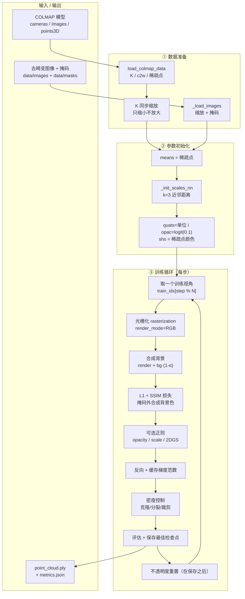
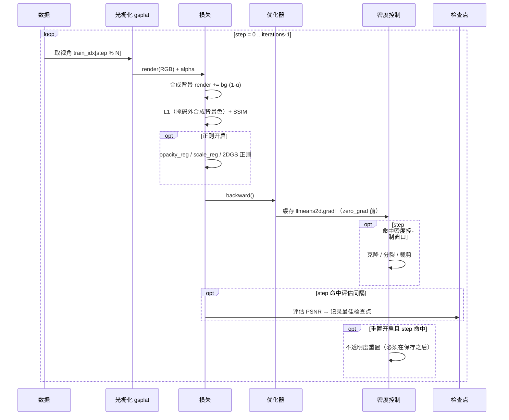

# 05 · 训练框架（提炼）

> 面向"要读/改训练代码"的人。**只讲训练**，不讲 Web、不讲导出。
> 每个设计决策都标注了**实测依据**（对应 [03-踩坑记录](03-踩坑记录.md) 的条目），
> 因为这里几乎每条规则都是踩过坑才定下来的。
>
> 全部实现在 `src/gsflow/trainers/`：`gsplat_trainer.py`（训练器本体，约 1460 行）
> + `gsplat_backend.py`（薄适配层，把 `StageContext` 的配置喂进 `TrainConfig`）。

---

## 0. 一张图看全（PNG，任何阅读器都能看）


> 由 `python scripts\make_training_flow_png.py` 生成，可重复运行。
> 图上的函数名/参数名都取自代码实际定义，可用 `python scripts\show_trainer_steps.py` 复核。

---

## 1. 一句话与模块划分

**一句话**：读 COLMAP 稀疏模型 + 去畸变图像 → 初始化高斯参数 → 用 gsplat 光栅化做
可微渲染 → L1+SSIM 反传 → 周期性密度控制（克隆/分裂/裁剪）→ 保存 PLY。



---

## 2. 数据准备（`load_colmap_data` / `_load_images`）

| 步骤 | 做什么 | 关键点 |
|---|---|---|
| 选模型目录 | `find_model_dir` → `sparse/<best>` | **必须按"注册图像数最多"选**：COLMAP 常把最优模型写到 `sparse/2`，硬编码 `sparse/0` 会拿到 2 张图的那种（03/G31） |
| 读内参 | 支持 SIMPLE_PINHOLE / PINHOLE / SIMPLE_RADIAL / OPENCV | 字段数不同，解析要按 `camera.model` 分支 |
| 读位姿 | `images.bin` → `c2w`（相机→世界） | 训练用 `viewmat = inv(c2w)` |
| 翻转相机轴 | `flip_camera`（默认关） | 坐标系约定差异时用 |
| 图像缩放 | `max_side = resolution`，**上限为数据集原生长边** | `resolution` 的语义是"缩放"，**放大也照做**。默认 1600 在 720px 素材上会放大 2.2 倍：不增信息只更慢（03/G73） |
| 内参同步 | `K[i,0,:] *= w/ow`，`K[i,1,:] *= h/oh` | 不缩放 K 会导致渲染与真值**尺度错位** |
| 掩码 | `data/masks/<stem>.png` > 127 | 掩码与图像**必须一一对应**；数量不等会让 mask 与 image 错位 |

> ⚠️ **一个已被修掉的坑**：去畸变数据复用时，原判断是
> `registered == 0 or n_undist >= registered`，`registered == 0` 时**无条件放行**，
> 于是任何残留的旧 `04_train/data` 都会被静默复用（03/G72）。
> 现在没有模型可比对时会**明确警告**。

---

## 3. 参数初始化

| 参数 | 初始化 | 依据 |
|---|---|---|
| `means` | 直接用 COLMAP 稀疏点（超过 `cap_max` 则随机下采样） | 官方 3DGS 同源 |
| `scales` | `log(sqrt(mean‖p−knn(p)‖²))`，k=3，再 `repeat(1,3)` | 官方用近邻距离，比固定值收敛快 |
| `quats` | 单位四元数 `[1,0,0,0]` | — |
| `opacities` | `logit(0.1)` | 官方同源 |
| `shs` | 稀疏点 RGB → `(rgb-0.5)/C0`，高阶置 0 | `C0=0.28209` |

**参数用字典管理**（`params = {"means":…, "scales":…}`），与官方 gsplat 一致 ——
因为**密度控制会替换参数对象**，必须能整体迁移优化器状态（03/G31 记录过零散移植失败三次）。

---

## 4. 优化器与学习率

```python
_LR = {"means": 1.6e-4, "scales": 5e-3, "quats": 1e-3,
       "opacities": lr_opacities,   # 默认 0.025（官方 0.05；实测 0.025 更稳）
       "shs": 2.5e-3}
```

- 调度：`schedule_lrs(step)` 手动实现 `ExponentialLR`（`lr = base * γ^step`）。
  **不用 `torch` 的调度器对象**：密度控制替换参数后调度器会失效。
- `lr_opacities` 可通过配置调整（默认 0.025）。

---

## 5. 训练循环逐步说明



### 5.1 损失

```python
l1 = (render - gt).abs()
# 掩码：把 GT 在掩码外合成为背景色，损失仍在全图上算
if masks and step < iterations * mask_loss_until:
    gt = torch.where(mask[..., None], gt, background)
loss = (1 - ssim_weight) * l1.mean() + ssim_weight * (1 - ssim(render, gt))
```

- `ssim_weight` 默认 0.2（官方同源）。
- **掩码损失有 `mask_loss_mode` 两个口径**（`config.py` 有完整说明）：
  - `composite`（默认）：GT 掩码外合成背景色，**全图**求损失。
    前景监督真实像素、背景监督"必须渲染成背景色"、各视角 loss 尺度一致。
  - `inside`：旧行为，只在掩码内取均值。**不要用** —— 掩码外无监督 ⇒
    模型在背景任意生成高斯 ⇒ 渲染"糊出去"、该空洞处破碎。
    受控实测：法线一致性 +3.5%、法线相关深度误差改善（03/G74）。

### 5.2 正则项（默认全关）

| 配置 | 作用 | 实测结论 |
|---|---|---|
| `opacity_reg` | 惩罚平均不透明度，抑制"看不见的浮点" | 默认 0；开启需对照 |
| `scale_reg` | 惩罚尺度，抑制膨胀 | 默认 0 |
| `lambda_depth_distortion` | 2DGS 深度失真抑制 | **默认 0**：直接套 2DGS 权重有害（03/G52） |
| `lambda_normal` | 2DGS 法线一致性 | **默认 0**：修正法线轴后仍不收敛（03/G65） |
| `flatten_2dgs` | 2DGS 参数化（只钳最短轴 log 尺度） | **默认 false**：法线场 +3.9%、网格略好，但 PSNR −1.15 dB（03/G67） |

> 这段保留接口是为了"换参数化后再实验"，不是因为我们没试过。

### 5.3 渐进分辨率

前 `15%` 迭代用**半分辨率**热身，之后切全分辨率。
省显存、前期收敛更快（官方 gsplat 也有类似做法）。

### 5.4 密度控制

两种实现，由 `densify_strategy` 选择：

| 值 | 实现 | 说明 |
|---|---|---|
| `builtin`（默认） | 本项目自实现 | 已按官方 `DefaultStrategy` 的语义对齐（阈值/尺度比例） |
| `official` | 直接复用 `gsplat.DefaultStrategy` | 含 AbsGS 的 `absgrad` 支持；实测 `absgrad` 无收益（03/G53） |

判据要点（**照抄官方语义，不要自己发明**）：

- 用**屏幕空间**的 `means2d` 梯度，不是 3D 的 `means.grad`；
  官方还会 `grads *= width/2*n_cameras`（按分辨率归一化）与
  `grad2d / count.clamp_min(1)`（除以被看到次数）。**这两步在官方代码里，别重复做。**
- 分裂/克隆的界线是尺度相对 `scene_scale` 的比例：
  `grow_scale3d=0.01`（小于走克隆、大于走分裂）、`prune_scale3d=0.1`（超过直接裁剪）。
- `densify_until=4000` 优于官方 15000：高斯少 68% 且不退化（03/G50）。
- **把窗口放到 15000 实测无收益**：高斯 3.6 倍、PSNR +0.05 dB、翻转率略差（03/G73）。
- `cap_max=600000` 是显存守护：达到上限就停止分裂。

### 5.5 顺序红线（保存 → 评估 → 重置）

```
… → 密度控制 → 评估 & 保存最佳检查点 → 不透明度重置 → 下一步
```

**重置必须在保存之后**，且**最后一步跳过重置**。
否则"最终检查点"保存的是**刚被重置完的状态**（不透明度被钳到 `logit(prune_opa*2)`），
表现为导出模型近乎全白（03/G44 记录了 p50 0.0138 → 修复后 0.1205）。

---

## 6. 评估协议（**PSNR 只在同协议下可比**）

| 项 | 规则 |
|---|---|
| 留出集 | `imgs` 的 10%（`min_imgs_for_holdout` 以下不留）；用固定 seed 打乱 |
| 日志评估 | 固定取前 `eval_quick_views`（默认 3）个留出视图 | 
| 最终评估 | **全部留出视图**（这才是可信指标） |
| 度量 | 全图 MSE（渲染与 GT 都合成同一背景色） |
| 陷阱 | 训练视图是**循环**取的，`eval_interval` 与循环长度不互质时两次评估会落在**同一相位**，看到同一张"难图"，被误读成"训练不稳定"（03/G32） |

> **实测教训**：同一个作业既报过 22.15 dB（20 视图）又报过 18.71 dB（3 视图）。
> **跨运行比较 PSNR 必须确认视图数、迭代数、分辨率完全一致。**

---

## 7. 检查点与产物

- **每个评估点都保存** `point_cloud/iteration_N/point_cloud.ply`，
  并在 `metrics.json` 里记录 `best_ply` / `best_psnr` / `best_step`。
- **导出阶段优先用 `best_ply`**，而不是最后一步 —— 最后一步可能被重置污染。
- `save_ply` 写标准 3DGS 字段：`x y z / nx ny nz / f_dc_* / f_rest_* / opacity / scale_* / rot_*`。

---

## 8. 后端协议（可插拔）

```python
# trainers/base.py（协议）
def run(ctx, data_dir, out_dir, iterations) -> dict   # 返回 metrics
```

- `gsplat`（默认）：本项目实现 + gsplat 光栅化。
- `official`：原版 3DGS（需自编译 CUDA）。
- `external`：自备脚本，`train.external_entry` 指定入口。
- 新增后端只要实现上面的协议并在 `pick()` 注册，CLI/GUI/编排器都不用改。

---

## 9. 改训练代码时的检查清单

1. **新配置项**：加进 `config.DEFAULTS['train']` **和** `TrainConfig`（两处默认值必须一致，
   `scripts/check_config_sync.py` 会校验）。只想临时调参可用 GUI「高级参数」。
2. **读配置**：用 `ctx.cfgt(key, default, cast)`，**不要** `ctx.cfg(k, d) or d`（会吞掉 `0`）。
3. **改默认值**：必须在**两份差异明显的数据**上验证；单素材调参 = 过拟合（03/G48）。
4. **对比实验**：用 `scripts/ab_loss_mode.py` 让两个配置**共用同一份 `04_train/data`**，
   否则测到的是 COLMAP 的运行间差异（03/G74）。
5. **几何/公式改动**：先构造**能笔算出答案**的用例（正对相机的平面法线必须是 `[0,0,-1]`），
   否则不退化但错 26.6° 的 bug 会静默留下来（03/G51）。
6. **顺序敏感的逻辑**（保存/评估/重置）：改动后必须检查**最终检查点的不透明度分布**，
   而不是只看 PSNR —— "薄雾退化"能骗过所有指标（03/G44）。
