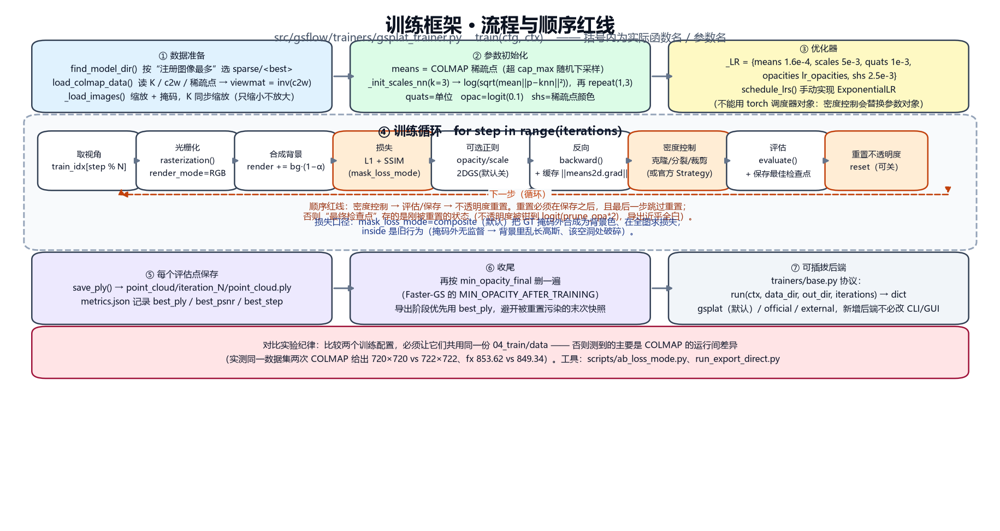
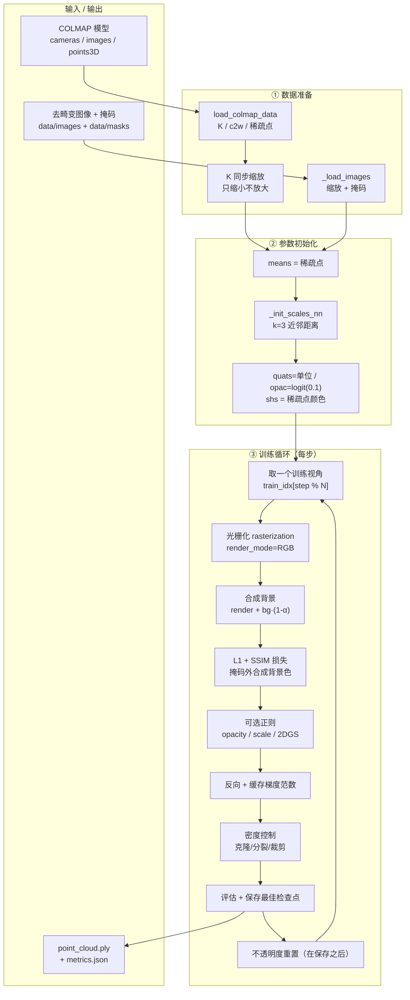
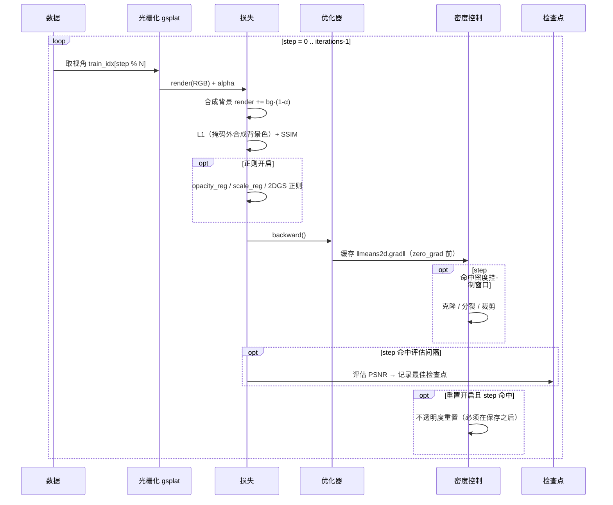

# 05 · 训练框架（提炼）

> 面向"要读/改训练代码"的人。**只讲训练**，不讲 Web、不讲导出。
> 每个设计决策都标注了**实测依据**（对应 [03-踩坑记录](03-踩坑记录.md) 的条目），
> 因为这里几乎每条规则都是踩过坑才定下来的。
>
> 全部实现在 `src/gsflow/trainers/`：`gsplat_trainer.py`（训练器本体，约 **2230 行**）
> + `gsplat_backend.py`（薄适配层，把 `StageContext` 的配置喂进 `TrainConfig`）。
>
> **2026-10 有两处口径变化，读旧结论前必须先看**：
> ① 掩码损失曾对 L1 **完全无效**（顺序 bug，03/G123），项目里所有**历史全图 PSNR/SSIM**
> 都是那个状态下的数字；现在质量判据是 **`psnr_masked` / `ssim_masked`**（见 §7.1）。
> ② `grad2d` 判据曾**从未真正生效**（孤儿 `elif`，03/G109）；现在默认生效，
> 其价值是"同等质量少 ~48% 高斯"（见 §6.4）。

---

## 0. 一张图看全（PNG，任何阅读器都能看）



> 由 `python scripts\make_training_flow_png.py` 生成，可重复运行。
> 图上的函数名/参数名都取自代码实际定义，可用 `python scripts\show_trainer_steps.py` 复核。

---

## 1. 一句话与模块划分

**一句话**：读 COLMAP 稀疏模型 + 去畸变图像 → 初始化高斯参数 → 用 gsplat 光栅化做
可微渲染 → L1+SSIM 反传 → 周期性密度控制（克隆/分裂/裁剪）→ 保存 PLY。



---

## 2. 数据准备（`load_colmap_data` / `_load_images`）

| 步骤 | 做什么 | 关键点 |
|---|---|---|
| 选模型目录 | `find_model_dir` → `sparse/<best>` | **必须按"注册图像数最多"选**：COLMAP 常把最优模型写到 `sparse/2`，硬编码 `sparse/0` 会拿到 2 张图的那种（03/G31） |
| 读内参 | 支持 SIMPLE_PINHOLE / PINHOLE / SIMPLE_RADIAL / OPENCV | 字段数不同，解析要按 `camera.model` 分支 |
| 读位姿 | `images.bin` → `c2w`（相机→世界） | 训练用 `viewmat = inv(c2w)` |
| 翻转相机轴 | `flip_camera`（默认关） | 坐标系约定差异时用 |
| 图像缩放 | `max_side = resolution`，**上限为数据集原生长边** | `resolution` 的语义是"缩放"，**放大也照做**。默认 1600 在 720px 素材上会放大 2.2 倍：不增信息只更慢（03/G73） |
| 内参同步 | `K[i,0,:] *= w/ow`，`K[i,1,:] *= h/oh` | 不缩放 K 会导致渲染与真值**尺度错位** |
| 掩码 | `data/masks/<stem>.png` > 127 | 掩码与图像**必须一一对应**；数量不等会让 mask 与 image 错位 |

> ⚠️ **一个已被修掉的坑**：去畸变数据复用时，原判断是
> `registered == 0 or n_undist >= registered`，`registered == 0` 时**无条件放行**，
> 于是任何残留的旧 `04_train/data` 都会被静默复用（03/G72）。
> 现在没有模型可比对时会**明确警告**。

---

## 3. 参数初始化

| 参数 | 初始化 | 依据 |
|---|---|---|
| `means` | 直接用 COLMAP 稀疏点（超过 `cap_max` 则随机下采样） | 官方 3DGS 同源 |
| `scales` | `log(sqrt(mean‖p−knn(p)‖²))`，k=3，再 `repeat(1,3)` | 官方用近邻距离，比固定值收敛快 |
| `quats` | 单位四元数 `[1,0,0,0]` | — |
| `opacities` | `logit(0.1)` | 官方同源 |
| `shs` | 稀疏点 RGB → `(rgb-0.5)/C0`，高阶置 0 | `C0=0.28209` |

**参数用字典管理**（`params = {"means":…, "scales":…}`），与官方 gsplat 一致 ——
因为**密度控制会替换参数对象**，必须能整体迁移优化器状态（03/G31 记录过零散移植失败三次）。

---

## 4. 优化器与学习率调度

```python
_LR = {"means": 1.6e-4, "scales": 5e-3, "quats": 1e-3,
       "opacities": lr_opacities,   # 默认 0.025（官方 0.05；实测 0.025 更稳）
       "shs": 2.5e-3}
```

### 4.1 调度：线性预热 + 余弦退火（`lr_schedule="cosine"`，默认）

```python
def lr_at(step, peak, min_ratio, warmup, total):
    if warmup > 0 and step < warmup:
        return peak * (step + 1) / warmup          # 线性预热
    prog = (step - warmup) / max(total - warmup, 1)
    return min_lr + 0.5 * (peak - min_lr) * (1 + cos(pi * prog))
```

| 配置 | 默认 | 说明 |
|---|---|---|
| `lr_schedule` | `"cosine"` | `"exp"` = 旧的纯指数衰减（保留以复现历史 / 做 A/B） |
| `warmup_iters` | `0` | 预热步数；建议取迭代数的 5%~10%（20000 → 1000~2000） |
| `lr_min_ratio` | `0.1` | 余弦退火下限（占峰值比例） |
| `lr_quats` | `1e-3` | 四元数学习率（**实测 5e-4 更差**，见 4.2） |

- **为什么预热**：Adam 早期用极少样本估计二阶矩，**初期步长极不稳定**；
  四元数（旋转流形）与尺度（对数域）对步长尤其敏感，前几百步震荡会把点云"甩"到坏区域。
- **为什么余弦**：中段衰减慢、末段加速，契合"先探索、后固化精细结构"。
- **不能用 `torch` 的调度器对象**：密度控制会替换参数对象并迁移优化器状态，
  调度器持有的引用会失效（曾在 `ExponentialLR` 上踩过，03/G31）。
- 曲线本体是**模块级** `lr_at()`，可用解析端点直接单测
  （`tests/test_lr_schedule.py`、`scripts/check_lr_schedule.py`）。

### 4.2 实测结论（同数据受控，20000 迭代 / 202 图 / 721px）

| 改动 | 对照结果 | 采用？ |
|---|---|---|
| 预热 1500 + 余弦 vs 纯指数 | 24.274 vs 24.287（**−0.013，噪声内**）| 采用（更符合原理，无代价）|
| `lr_quats` 5e-4 vs 1e-3 | 24.187 vs **24.264** | **不采用**，保持 1e-3 |

> "社区确实这么做、论文也这么说"**不能替代本地实测**。详情见 03/G75。

---

## 5. 损失函数

### 5.1 主损失：L1 + SSIM

```python
loss = (1 - ssim_weight) * l1.mean() + ssim_weight * (1 - ssim(render, gt))
```

- `ssim_weight` 默认 0.2（官方同源）。
- **实测各分量量级**（`scripts/probe_loss_scales.py`，已训练模型上）：
  L1 = 0.0530，**1−SSIM = 0.3324（是 L1 的 6.3 倍）**，主损失 = 0.1089。
  ⇒ SSIM 项实际**主导**损失；改 `ssim_weight` 前先意识到这一点。

### 5.2 掩码损失的两个口径（`mask_loss_mode`）

| 值 | 行为 | 评价 |
|---|---|---|
| `composite`（默认）| GT 掩码外合成为背景色，损失在**全图**上算 | 前景监督真实像素、背景监督"必须渲染成背景色"、各视角尺度一致 |
| `inside` | 旧行为：只在掩码内取均值 | **不要用**：掩码外无监督 ⇒ 背景乱长高斯、该空洞处破碎、loss 尺度随前景占比漂移 |

### 5.3 感知损失 LPIPS（`lambda_lpips`，默认 **0 = 关闭**）

自己实现（`trainers/perceptual.py`，VGG16 + 通道归一化），不依赖 `lpips` 包。

**先说两个测量前提**（我曾因忽略它们得出错误结论，见 03/G79、G81）：

1. **噪声底**：同配置重复训练的 PSNR 标准差约 **0.03~0.05 dB**
   ⇒ 小于该量级的差异**不能**作为"有效/无效"的依据；
2. **渲染必须用完整 SH**：用 `sh_degree=0` 会低估 **1.91 dB**，
   并抹掉**视角相关**外观 —— 那正是感知损失要改善的部分。

**3 次重复的统计判定**（同数据、12000 迭代、每格 n=3）：

| 指标 | λ=0 | λ=0.05 | 差异 95% CI | 判定 |
|---|---|---|---|---|
| PSNR | 23.619（s=0.026）| 23.611（s=**0.080**）| [−0.217, +0.202] | 不显著 |
| SSIM | — | −0.0005 | [−0.0041, +0.0030] | 不显著 |
| LPIPS | — | −0.0006 | [−0.0040, +0.0027] | 不显著 |

- **三个指标全部不显著** ⇒ λ=0.05 下测不出收益。
- **但方差约 3 倍**（0.080 vs 0.026）⇒ 感知损失明显**增加训练不稳定**。
- **局限**：n=3 时 CI 很宽（PSNR 覆盖 ±0.21 dB），**不能断言"LPIPS 永远无用"**；
  只能说本配置下无收益、且更不稳。更强结论需更多重复或更长训练。
- 另外：我曾据**单次**运行判它"有害"并删掉代码 —— 那是错的（差异在噪声内）。代码已恢复。

工程要点：
- 权重需先落盘：`python scripts\fetch_torch_weights.py`（VGG16 527.8 MB，会校验可加载）。
- `lpips_every`（默认 4）隔步计算，控制显存与时间。
- **缺权重时抛异常**，训练侧捕获后**永久关闭**该项并 WARN；
  **绝不给 0** —— "开着但没生效"无法察觉（03/G77）。

### 5.4 正则项与量级纪律

| 配置 | 默认 | 实测 |
|---|---|---|
| `opacity_reg` / `scale_reg` | 0 | 未启用 |
| **`lambda_depth_distortion`** | **0** | **λd=1.5 在同批对照中 +0.199 dB（显著）**，是唯一站得住的改进；但**网格未明显改善**（见下）|
| `lambda_normal` | 0 | 修正法线轴后仍不收敛（03/G65）|
| `flatten_2dgs` | false | 法线场 +3.9%，但 PSNR −1.15 dB（03/G67）|

**λd 的权重必须按本项目的损失口径实测校准，不能照抄论文**：
2DGS 论文的 λd=1000 作用于未归一化的 `Σωᵢωⱼ(dᵢ−dⱼ)²`，与本项目的深度图 TV 代理
**尺度不可比**。用 `scripts/probe_loss_scales.py` 实测量级
（depth_tv≈0.0073、RGB 主损失≈0.1089）⇒ 要占 RGB 的 5%~10% 需 **λd≈0.75~1.5**（03/G76）。

**λd=1.5 的完整代价**（只看 PSNR 会漏掉一半，见 03/G82）：

| 指标 | λd=0 | λd=1.5 | 判定 |
|---|---|---|---|
| PSNR | 24.121 | **24.320** | ✅ 显著 |
| 深度误差中位数 / p90 | 8.02% / 28.70% | **7.04% / 25.12%** | ✅ 改善 |
| 轮廓 IoU | **0.802** | 0.793 | 🔶 略差 |
| 法线翻转率 | **17.9%** | 22.4% | ❌ 变差 |
| 边流形 | False | **True** | ✅ 改善 |

⇒ 表面更贴合、拓扑更干净，但**法线翻转更严重**；**没有解决"网格破碎"**。

---

## 6. 训练循环逐步说明



### 6.1 损失

```python
# ⚠️ 顺序是有讲究的：**先把 GT 在掩码外合成为背景色，再算 l1**。
# 2026-10 修过一个致命顺序错误（docs/03 G123）：
#
#     l1 = (render - gt).abs()          # ← 用**原始** gt 算好了
#     if masks: gt = where(mask, gt, background)   # ← 只替换 gt
#     l1 = l1.mean()                     # ← 用的还是**旧** l1
#
# 于是 `composite` 对 L1 **完全没生效**（只影响 SSIM，权重 0.2），背景被当主体拟合。
# 症状：掩码外渲染亮度 0.904（应为 0）、`inside` 与 `composite` 几乎无差别。
_mask = masks[idx] if (masks and step < iterations * mask_loss_until) else None
if _mask is not None and mask_loss_mode != "inside":
    gt = torch.where(_mask[..., None], gt, background)      # ← 必须先做这一步
l1 = (render - gt).abs()
if _mask is not None and mask_loss_mode == "inside":
    l1 = l1[_mask]                                           # 旧行为（仅对照）
loss = (1 - ssim_weight) * l1.mean() + ssim_weight * (1 - ssim(render, gt))
```

- `ssim_weight` 默认 0.2（官方同源）。
- **掩码损失有 `mask_loss_mode` 两个口径**（`config.py` 有完整说明）：
  - `composite`（默认）：GT 掩码外合成背景色，**全图**求损失。
    前景监督真实像素、背景监督"必须渲染成背景色"、各视角 loss 尺度一致。
    修复后实测：掩码外渲染亮度 **0.005**（修复前 0.904）。
  - `inside`：旧行为，只在掩码内取均值。掩码外无监督 ⇒ 模型在背景任意生成高斯。
    **受控实测（2026-10，2 重复 × 15k 迭代）**：改 `inside` 后亮背景占视觉权重
    61.2% → 59.6%（几乎不变）、全图 PSNR −1.18 dB、高斯 +45%
    ⇒ 它**不能**解决背景问题，只在做对照时用（03/G122）。

### 6.2 正则项（默认全关）

| 配置 | 作用 | 实测结论 |
|---|---|---|
| `opacity_reg` | 惩罚平均不透明度，抑制"看不见的浮点" | 默认 0；开启需对照 |
| `scale_reg` | 惩罚尺度，抑制膨胀 | 默认 0 |
| `lambda_depth_distortion` | 2DGS 深度失真抑制 | **默认 0**：直接套 2DGS 权重有害（03/G52） |
| `lambda_normal` | 2DGS 法线一致性 | **默认 0**：修正法线轴后仍不收敛（03/G65） |
| `flatten_2dgs` | 2DGS 参数化（只钳最短轴 log 尺度） | **默认 false**：法线场 +3.9%、网格略好，但 PSNR −1.15 dB（03/G67） |

> 这段保留接口是为了"换参数化后再实验"，不是因为我们没试过。

### 6.3 渐进分辨率

前 `15%` 迭代用**半分辨率**热身，之后切全分辨率。
省显存、前期收敛更快（官方 gsplat 也有类似做法）。

### 6.4 密度控制

两种实现，由 `densify_strategy` 选择：

| 值 | 实现 | 说明 |
|---|---|---|
| `builtin`（默认） | 本项目自实现 | 已按官方 `DefaultStrategy` 的语义对齐（阈值/尺度比例） |
| `official` | 直接复用 `gsplat.DefaultStrategy` | 含 AbsGS 的 `absgrad` 支持；实测 `absgrad` 无收益（03/G53） |

判据要点（**照抄官方语义，不要自己发明**）：

- 用**屏幕空间**的 `means2d` 梯度，不是 3D 的 `means.grad`；
  官方还会 `grads *= width/2*n_cameras`（按分辨率归一化）与
  `grad2d / count.clamp_min(1)`（除以被看到次数）。**这两步在官方代码里，别重复做。**
- 判据由 `densify_criterion` 选择，默认 **`grad2d`**（官方语义）：
  - `grad2d`：屏幕空间梯度，阈值 `densify_grad2d_threshold=2e-4`（官方默认）；
  - `grad3d`：3D 均值梯度（旧实现），阈值 `densify_grad3d_threshold`。
  - ⚠️ **曾经 `grad2d` 从未真正生效**：一个孤儿 `elif` 每步都用 3D 梯度覆盖了它，
    还打了 30,000 条假告警（03/G109）。改动这块后**必须**用
    `scripts/check_train_used_config.py` 确认日志里报告的判据与配置一致。
- 分裂/克隆的界线是尺度相对 `scene_scale` 的比例：
  `grow_scale3d=0.01`（小于走克隆、大于走分裂）、`prune_scale3d=0.1`（超过直接裁剪）。
- `densify_until=4000` 优于官方 15000：高斯少 68% 且不退化（03/G50）。
- **把窗口放到 15000 实测无收益**：高斯 3.6 倍、PSNR +0.05 dB、翻转率略差（03/G73）。
- `cap_max=600000` 是显存守护：达到上限就停止分裂。

#### 5.4.1 `grad2d` 到底买到了什么（受控实测，2026-10，03/G117）

同数据、2 重复、15k 迭代、95% 置信区间：

| 判据 | PSNR 均值 | 95% CI | 高斯数 |
|---|---|---|---|
| `grad2d` @ 2e-4（默认）| 27.520 | [26.968, 28.073] | 96,346 |
| `grad3d` | 27.438 | [26.981, 27.895] | **141,960（+48%）** |
| `grad2d` @ 1e-4 | 27.276 | [26.583, 27.968] | **181,264（+89%）** |

⇒ **质量无显著差异**（CI 跨 0）；`grad2d` 的价值是**同等质量下少约一半高斯**。
把阈值降到 1e-4 **没有**质量收益、还多 89% 高斯 —— 这推翻了我"激活率只有 9%、
多半是阈值偏高"的猜测。

### 6.5 顺序红线（保存 → 评估 → 重置）

```
… → 密度控制 → 评估 & 保存最佳检查点 → 不透明度重置 → 下一步
```

**重置必须在保存之后**，且**最后一步跳过重置**。
否则"最终检查点"保存的是**刚被重置完的状态**（不透明度被钳到 `logit(prune_opa*2)`），
表现为导出模型近乎全白（03/G44 记录了 p50 0.0138 → 修复后 0.1205）。

---

## 7. 评估协议（**PSNR 只在同协议下可比**）

| 项 | 规则 |
|---|---|
| 留出集 | `imgs` 的 10%（`min_imgs_for_holdout` 以下不留）；用固定 seed 打乱 |
| 日志评估 | 固定取前 `eval_quick_views`（默认 3）个留出视图 | 
| 最终评估 | **全部留出视图**（这才是可信指标） |
| 度量 | **掩码内** MSE/SSIM（主判据）+ 全图 MSE（记录用，**掩码生效后不代表画质**）|
| 陷阱 | 训练视图是**循环**取的，`eval_interval` 与循环长度不互质时两次评估会落在**同一相位**，看到同一张"难图"，被误读成"训练不稳定"（03/G32） |

> **实测教训**：同一个作业既报过 22.15 dB（20 视图）又报过 18.71 dB（3 视图）。
> **跨运行比较 PSNR 必须确认视图数、迭代数、分辨率完全一致。**

### 7.1 掩码生效后，全图指标**必然失效**（2026-10 起）

掩码外被有意压成背景色后，全图 MSE 主要来自"该黑的背景渲成了亮的模型"，
与物体画质无关。同一个模型：

| 指标 | 全图 | **掩码内** |
|---|---|---|
| PSNR | 3.41 dB | **20.47 dB** |
| SSIM | 0.367 | **0.946** |

⇒ `evaluate()` 同时返回 `psnr` / `ssim` 与 **`psnr_masked` / `ssim_masked`**，
一并写进 `psnr_log`、`metrics.json`、`job.json`。质量判据用**掩码内**那组。

- 判据自查：`psnr_masked - psnr` 应 **> 3 dB**；两者接近 ⇒ 掩码又没生效（G123 症状）。
  已写进 `scripts/final_acceptance.py`。
- ⚠️ **项目里 27~31 dB 那类历史全图 PSNR 与新口径不可直接比较**：
  它们是"背景也参与拟合"时的数字，其中 63% 的画面是均匀亮背景。

---

## 8. 检查点与产物

### 8.0 网格参数的质量纪律（**只看 PSNR 会漏掉一半**）

导出网格的参数**不能只按"更细更好"来调**。实测（同模型、同一份输入点云，
只改一个参数，同时量**翻转率**与**轮廓 IoU** —— 只量翻转率可以靠"删表面"作弊）：

| 参数 | 改动 | 翻转率 | 轮廓 IoU | 判定 |
|---|---|---|---|---|
| `mesh_poisson_depth` | 9 → **8** | 22.4% → **2.1%** | 0.793 → 0.779 | ✅ **代价极小** |
| `mesh_poisson_depth` | 9 → 10 | 22.4% → **43.5%** | — | ❌ **更深反而更差** |
| `mesh_consistency_min_views` | 2 → 3 | 22.4% → 12.6% | 0.793 → **0.733** | ❌ IoU 代价太大 |
| `mesh_trim_sigma` | 2.5 → 1.0 | 22.4% → 3.2% | 只剩 1.6 万面 | ❌ 裁太狠 |
| `mesh_crop_quantile` | 0.95 → **1.0** | 22.4% → 44.0%（**网格变小后**）| ✅ 但这是**不得已的回归**，见下 |

> ⚠️ **`mesh_crop_quantile` 这一行已被推翻**（2026-10，03/G119）。
> 上表 0.95→1.0 时翻转率从 22.4% 升到 44%，我当时据此保留了 0.95。
> 后来的实测证明：**分位数裁剪会把"稀疏但真实"的结构优先裁掉** ——
> 3DGS 把容量放在细节密集处，屋檐/翼角稀疏。
> 真实后果是网格只剩中央一块碎片：bbox 只有高斯的 25%/22%/15%、体积占比 **0.85%**、
> 表面积 **1.72**；改成 1.0 后表面积 **18.10**（10 倍）、覆盖视觉权重 **56.7% → 98.1%**。
> 翻转率在这种"能出完整网格"的对比里已经没有可比性 —— **不要用翻转率决定裁剪力度**。
> 背景污染改由 `mesh_crop_opacity`（按不透明度过滤）承担。

**翻转率的主因是泊松八叉树深度，不是法线来源或正则项**（后者试过很多次都没用）。
机理：翻转来自**几何自交** —— 该网格 `is_orientable()=False` 且
`orient_triangles()` **完全无效**（17.9% → 17.9%），所以不是可修的绕序；
更浅的八叉树产出**更平滑**的表面、自交更少，而 depth=10 **过拟合到噪声点**。

> 详细数据与跨模型验证见 [03-踩坑记录](03-踩坑记录.md) G82/G83。

**文档一致性检查**（改默认值后必须跑）：`python scripts\check_docs_consistency.py`
—— 它核对 `DEFAULTS` ↔ `TrainConfig` ↔ `config.toml` ↔ `README.md` 参数表 ↔ mermaid 图，
并且每一项都**先在已知坏输入上验证会失败**（`scripts\selftest_doc_checker.py`），
避免出现"永远通过"的假检查。

- **每个评估点都保存** `point_cloud/iteration_N/point_cloud.ply`，
  并在 `metrics.json` 里记录 `best_ply` / `best_psnr` / `best_step`。
- **导出阶段优先用 `best_ply`**，而不是最后一步 —— 最后一步可能被重置污染。
- `save_ply` 写标准 3DGS 字段：`x y z / nx ny nz / f_dc_* / f_rest_* / opacity / scale_* / rot_*`。

---

## 9. 后端协议（可插拔）

```python
# trainers/base.py（协议）
def run(ctx, data_dir, out_dir, iterations) -> dict   # 返回 metrics
```

- `gsplat`（默认）：本项目实现 + gsplat 光栅化。
- `official`：原版 3DGS（需自编译 CUDA）。
- `external`：自备脚本，`train.external_entry` 指定入口。
- 新增后端只要实现上面的协议并在 `pick()` 注册，CLI/GUI/编排器都不用改。

---

## 10. 改训练代码时的检查清单

1. **新配置项**：加进 `config.DEFAULTS['train']` **和** `TrainConfig`（两处默认值必须一致，
   `scripts/check_config_sync.py` 会校验）。只想临时调参可用 GUI「高级参数」。
2. **读配置**：用 `ctx.cfgt(key, default, cast)`，**不要** `ctx.cfg(k, d) or d`（会吞掉 `0`）。
3. **改默认值**：必须在**两份差异明显的数据**上验证；单素材调参 = 过拟合（03/G48）。
4. **对比实验**：用 `scripts/ab_loss_mode.py` 让两个配置**共用同一份 `04_train/data`**，
   否则测到的是 COLMAP 的运行间差异（03/G74）。
5. **几何/公式改动**：先构造**能笔算出答案**的用例（正对相机的平面法线必须是 `[0,0,-1]`），
   否则不退化但错 26.6° 的 bug 会静默留下来（03/G51）。
6. **顺序敏感的逻辑**（保存/评估/重置）：改动后必须检查**最终检查点的不透明度分布**，
   而不是只看 PSNR —— "薄雾退化"能骗过所有指标（03/G44）。
7. **改了一个中间量，就要重算所有下游**（本项目最贵的一类 bug，三次了）：
   - G109：孤儿 elif 用 3D 梯度覆盖了正确的 grad2d；
   - G123：l1 在"替换 GT"之前算好，导致掩码对 L1 从未生效。
   改完自问一句：**还有谁在用这个变量的旧快照？**
8. **每个"应该生效"的特性都要配一条症状守门**：掩码生效时 psnr_masked 必须显著高于
   psnr（> 3 dB）；不满足就是没生效。scripts/final_acceptance.py 已内置这一条。
9. **不要用渲染/合成后的产物反推中间变量**（G122：我用合成到白底的预览图推断
   "模型里亮高斯多"，结论是错的）。指标要从**产生它的那一层**取。
